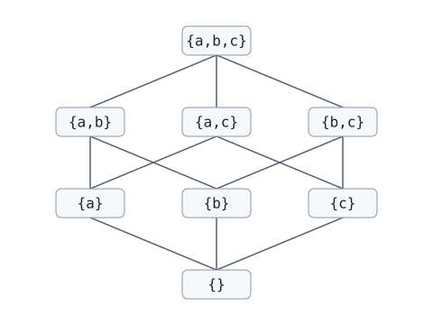

# Replicación leaderless

Dependencias y secuencia completa de la clase: [`main`](https://github.com/fiubaTA050/leaderless-replication/tree/main).

## Parte 4: CRDTs

Conflict-free Replicated Data Types: tipos de datos cuyas réplicas aceptan updates sin coordinación y siempre
convergen, sin conflictos que resolver.

Beneficio principal: cada réplica aplica sus updates localmente, sin hablar con ningún otro nodo en cada operación.
Una réplica puede ser un servidor, pero también un celular o un browser: sigue funcionando offline o con la red
partida, cada operación tiene la latencia de un cambio local, y los cambios se sincronizan cuando hay conexión
(local-first).

Dos familias:

- **State-based** (CvRDT): las réplicas se mandan el estado completo y lo combinan con `join`.
- **Operation-based** (CmRDT): las réplicas se mandan operaciones; necesitan entrega causal y exactly-once.

Vemos solo state-based (sin delta-state). Código en `crdt/`: TypeScript, tests con vitest y fast-check.

### Branch `5-crdt-lww`: join-semilattice y LWW-Register

```bash
git checkout 5-crdt-lww
cd crdt
npm install
npm test
```

#### Join-semilattice

Un **orden parcial** `≤` es reflexivo, antisimétrico y transitivo, pero no todo par es comparable. Ejemplo: los
subconjuntos de `{a,b,c}` ordenados por `⊆`; `{a}` y `{b}` no son comparables. El diagrama de Hasse muestra ese
orden:



Cómo se lee:

- Cada línea une un elemento con otro que está justo arriba en el orden, sin ninguno en el medio: `{a}` con
  `{a,b}`, pero no `{a}` con `{a,b,c}`.
- `x ≤ y` si se puede llegar de `x` a `y` subiendo por líneas: `{a} ≤ {a,b,c}` (pasando por `{a,b}` o `{a,c}`).
- Si no hay camino subiendo de uno al otro, no son comparables: `{a}` y `{b}`.
- El join de dos elementos es el primero al que se llega subiendo desde los dos: `{a} ⊔ {b} = {a,b}`.

El **least upper bound** (join, `⊔`) de `x` e `y` es el menor elemento que es `≥` que los dos. Acá es la unión:
`{a} ⊔ {b} = {a,b}`, `{a,b} ⊔ {b,c} = {a,b,c}`. Un **join-semilattice** es un orden parcial donde todo par tiene
join. Abajo de todo está **bottom** (`{}`): el estado inicial, antes de cualquier update.

Un join-semilattice queda completamente definido por:

| Componente | Qué es | En el ejemplo |
| --- | --- | --- |
| Dominio `S` | el conjunto de todos los valores (estados) posibles | los subconjuntos de `{a,b,c}` |
| Join `⊔ : S × S → S` | combina dos valores en otro de `S`; tiene que ser conmutativo, asociativo e idempotente | unión |
| Orden `≤` | sale del join: `a ≤ b` si `a ⊔ b = b` ("`b` ya incluye a `a`") | `⊆` |
| Bottom `⊥` (opcional) | el menor de todos: `⊥ ⊔ a = a` para todo `a` | `{}` |

Con el dominio y el join alcanza: el orden se deduce del join (y al revés: dado el orden, el join es el least
upper bound). Bottom no es obligatorio para ser un semilattice, pero un CRDT lo necesita como estado inicial de
cada réplica.

| Propiedad del join | Qué permite |
| --- | --- |
| Conmutativo: `a ⊔ b = b ⊔ a` | los estados pueden llegar en cualquier orden |
| Asociativo: `(a ⊔ b) ⊔ c = a ⊔ (b ⊔ c)` | da igual si llegan directo o a través de otra réplica |
| Idempotente: `a ⊔ a = a` | los duplicados no cambian nada (alcanza con at-least-once) |

Además:

- **Updates inflationary**: cada update solo sube en el orden (`s ≤ update(s)`). Un join nunca deshace un update.
- **Eventual delivery**: es un supuesto, no una garantía. El sistema tiene que hacer llegar cada estado a las demás
  réplicas (gossip, anti-entropy, reintentos…). Si una réplica nunca lo recibe (nunca se reconecta, o el estado se
  perdió), no converge: un CRDT no puede arreglar eso.

Con todo eso hay **strong eventual consistency**: dos réplicas que recibieron los mismos updates (en cualquier
orden, con duplicados) están en el mismo estado. Sigue siendo eventual: un update tarda en llegar a todas las
réplicas, y mientras tanto pueden diferir. Lo "strong" es que no hace falta nada más para converger (resolver
conflictos, elegir un ganador, hacer rollback): alcanza con que les lleguen los mismos updates.

Ejemplos de dominios con una operación que es un join:

| Dominio | Join | Ejemplo de uso |
| --- | --- | --- |
| Números | `max` | el precio más alto ofrecido en una subasta |
| Booleans | `or` | un flag que solo se prende ("aceptó los términos") |
| Conjuntos | unión | tags que solo se agregan |
| Estados que solo avanzan (`creado < pagado < enviado < entregado`) | el más avanzado | estado de un envío |

Operaciones que **no** sirven como join:

- Suma: `a + a ≠ a` (no es idempotente). Si un estado llega dos veces, se cuenta dos veces.
- Resta: `a - b ≠ b - a` (no es conmutativa).
- Promedio: `avg(avg(a, b), c) ≠ avg(a, avg(b, c))` (no es asociativo).

Comparación con lo que vimos:

- LWW de Cassandra también es un join-semilattice (orden por timestamp), pero el orden descarta writes
  concurrentes.
- Los siblings de Riak también son un join-semilattice: el estado son los valores concurrentes, cada uno con su dot,
  y el join entre réplicas se queda con los que ningún write posterior reemplazó (es un CRDT llamado
  Multi-Value Register). Lo que queda a cargo de la aplicación es combinar los siblings en un solo valor, y esa
  combinación no tiene por qué ser un join (la unión del carrito resucita items borrados).
- Al diseñar un CRDT se eligen el estado y el join (y con eso, el orden) para que el join conserve lo que importa
  de cada update, en vez de descartar uno de los writes concurrentes como hace LWW.

#### LWW-Register

En `crdt/src` implementamos un LWW-Register (`src/lwwregister.ts`).

Cada CRDT es una clase que implementa la interfaz `Crdt` de `src/crdt.ts`: `join` y `value`, lo que ve la
aplicación. Bottom es un atributo `static bottom` de cada clase (una interface no puede declarar miembros static).

```ts
export interface Crdt<T, V> {
  join(crdt: T): T;
  value(): V;
  // Solo para los tests: compara el estado completo, no solo value()
  equals(crdt: T): boolean;
}
```

Los estados no se modifican: cada update es un método que devuelve un estado nuevo. Por eso todas las réplicas
comparten la misma instancia de `bottom`. En `LWWRegister`, el update es `set(value, timestamp)`:

```ts
const a = LWWRegister.bottom.set('Ana', 1001);
const b = LWWRegister.bottom.set('Beto', 1000);
a.join(b).value(); // 'Ana'
```

El valor puede ser de cualquier tipo. Con timestamps iguales, gana el valor con el `JSON.stringify` mayor: es un
desempate arbitrario, pero todas las réplicas eligen el mismo, así que el join sigue siendo conmutativo. Bottom
tiene timestamp `-Infinity`: cualquier write le gana, así que el join no necesita un caso especial para bottom.

**Siguiente:** [`6-crdt-counters`](https://github.com/fiubaTA050/leaderless-replication/tree/6-crdt-counters)
