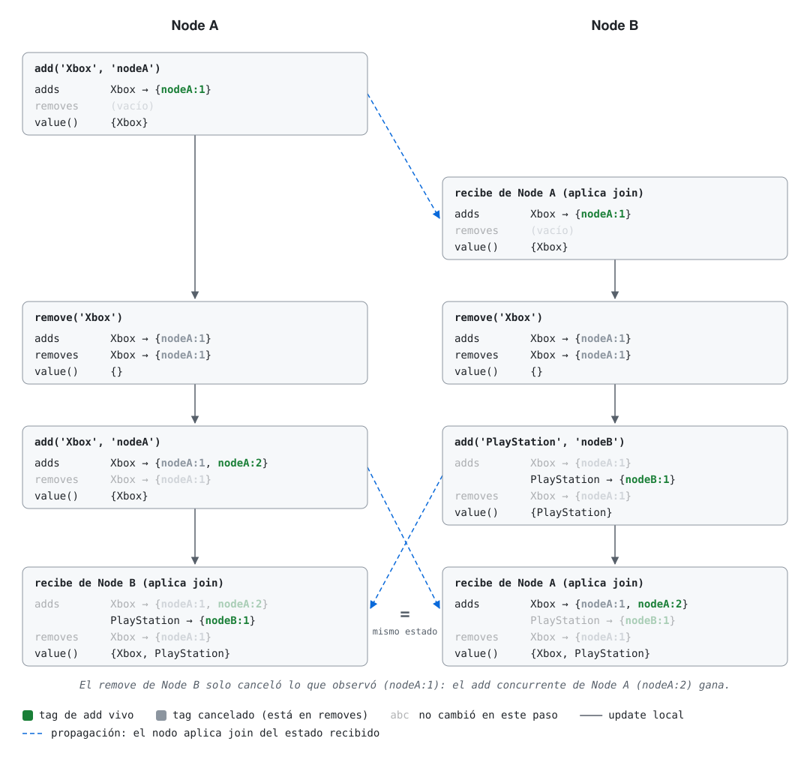
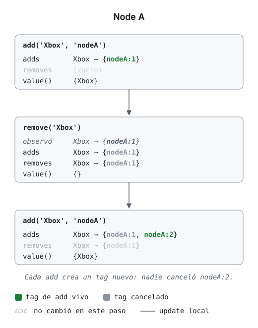
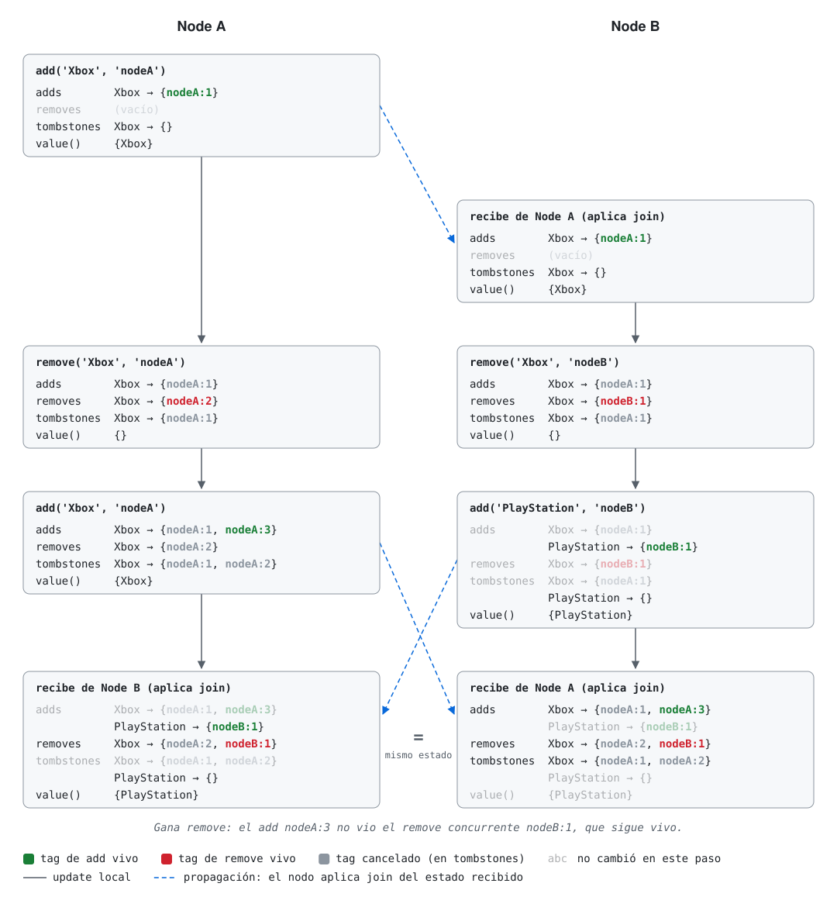

# Replicación leaderless

Dependencias y secuencia completa de la clase: [`main`](https://github.com/fiubaTA050/leaderless-replication/tree/main).

## Parte 4: CRDTs

### Branch `7-crdt-sets`: sets

```bash
git checkout 7-crdt-sets
cd crdt
npm install
npm test
```

Todos pasan `testCrdtLaws`. Lo que cambia entre ellos es la semántica cuando un add y
un remove del mismo elemento son concurrentes, y eso las leyes no lo ven: el OR-Set y el RW-set cumplen las
mismas leyes y dan respuestas opuestas. Por eso cada archivo de `test/` tiene, después de las leyes, tests comunes
de la semántica.

| CRDT | Archivo | Updates | Add y remove concurrentes | ¿Se puede volver a agregar? |
| --- | --- | --- | --- | --- |
| G-Set | `src/gset.ts` | `add(e)` | no hay remove | - |
| 2P-Set | `src/twopset.ts` | `add(e)`, `remove(e)` | gana remove | no |
| OR-Set | `src/orset.ts` | `add(e, replicaId)`, `remove(e)` | gana add | sí |
| RW-set | `src/rwset.ts` | `add(e, replicaId)`, `remove(e, replicaId)` | gana remove | sí |

Todos son clases que implementan `Crdt` (`join`, `value` y `equals`) con un `static bottom`; `value()` devuelve el
`Set` de elementos presentes.

#### G-Set

Solo agrega. Orden `⊆`, join: unión (el semilattice del diagrama de `5-crdt-lww`).

#### 2P-Set

Dos G-Sets: `added` y `removed` (tombstones). Está si está en `added` y no en `removed`. Un remove es para
siempre: un elemento borrado no se puede volver a agregar. Los tombstones no se pueden eliminar sin coordinación
(una réplica que no vio el remove lo haría volver: la resurrección de `3-cassandra-tombstones`).

#### OR-Set (add wins)

Cada add crea un **tag** único; los tags son determinísticos, `${replicaId}:${n}`, con `n` uno más que el último
que usó esa réplica para ese elemento. Un remove agrega a `removes` solo los tags que **observó**. Un elemento
está si tiene algún tag de add que no está en `removes`.

Con add y remove concurrentes, el add creó un tag que el remove no vio, así que el elemento queda: gana add.



Se puede volver a agregar: cada add crea un tag nuevo, que ningún remove anterior observó.



Los tags borrados también son tombstones y crecen (hay versiones optimizadas que los reemplazan por version
vectors).

Un tag `(replicaId, n)` es un **dot**, como en los dotted version vectors de Riak: identifica un evento, y un remove
cancela exactamente los dots que observó. Por eso los tags no se pueden repetir nunca.

#### RW-set (remove wins)

Simétrico al OR-Set: el remove también crea un tag.

- add: crea un tag de add y cancela (tombstone) los tags de remove que observó.
- remove: crea un tag de remove y cancela los tags de add que observó.
- Está si tiene un tag de add vivo y ningún tag de remove vivo.

Con add y remove concurrentes, ninguno canceló el tag del otro: queda un tag de remove vivo y gana remove. En orden
causal funciona como un set normal. Sirve cuando el remove es lo seguro (ej: revocar un permiso).



### Edición de texto: Operational Transformation y CRDTs

Editar el mismo texto desde varios lugares, incluso offline, tiene un problema propio: las operaciones usan
posiciones, y una edición concurrente las cambia. Texto `abc`: A inserta `X` en la posición 1 (`aXbc`) y, a la vez,
B borra la posición 2 (la `c`). Si A aplica el delete de B tal cual, borra la `b`.

- **Operational Transformation (OT)**: transforma cada operación remota contra las concurrentes que ya se
  aplicaron: el delete de la posición 2 pasa a ser de la posición 3. Google Docs usa OT: cada cambio va del editor
  al servidor y de ahí a los demás editores, que lo transforman ([Google, 2010](https://drive.googleblog.com/2010/09/whats-different-about-new-google-docs_22.html)). En general OT necesita
  un servidor que defina el orden de las operaciones.
- **CRDTs de secuencias** (RGA, YATA en Yjs, Automerge): cada carácter tiene un id único y las operaciones apuntan a
  ids, no a posiciones, así que conmutan sin transformarlas y no hace falta un servidor central.

Las dos permiten editar offline y sincronizar después.

### Problemas de los CRDTs

Un CRDT converge sin coordinación, pero lo paga con metadata, con supuestos sobre la red y con semántica que la
aplicación no siempre quiere.

#### Tombstones y garbage collection

Para que un remove funcione hay que recordar lo que se borró: los `removed` del 2P-Set, los tags en `removes` del
OR-Set, los caracteres borrados de un CRDT de texto (Yjs y Automerge guardan cada carácter que alguna vez existió).
La metadata crece con la historia, no con el valor: un set con 3 elementos puede tener millones de tags borrados.

Borrar un tombstone es seguro recién cuando ninguna réplica puede mandar algo concurrente con el remove: todas las
réplicas ya lo vieron, así que cualquier update futuro es posterior. Esa propiedad se llama **causal stability**
(Baquero, Almeida, Shoker, 2014). Para saberlo, cada réplica tiene que conocer:

- **quiénes son todas las réplicas** (membership), y
- **qué vio cada una** (un version vector por réplica).

Una réplica que no se conecta (un celular apagado hace meses) frena el garbage collection de todas: mientras no se
sepa qué vio, cualquier tombstone podría hacer falta. Las opciones son esperar, sacarla del grupo (coordinación) o
borrar igual después de un tiempo y aceptar resurrecciones: lo que hace Cassandra con `gc_grace_seconds` en
`3-cassandra-tombstones`.

#### IDs de réplicas y membership

El G-Counter, los version vectors y los tags tienen una entrada por cada réplica que alguna vez escribió. Con
réplicas efímeras (cada browser o cada celular es una réplica) crecen sin límite, y sacar la entrada de una réplica
que se fue sin perder sus updates necesita acuerdo entre las demás. Un `replicaId` tampoco se puede reusar: dos
réplicas con el mismo id generan el mismo dot para eventos distintos, y el G-Counter o el OR-Set dejan de
converger. Los handoff counters de las referencias atacan este problema para counters.

#### Supuestos sobre la red

- **State-based** (los de este repo): toleran mensajes duplicados, perdidos y desordenados, porque `join` es
  idempotente, conmutativo y asociativo. Pero cada sync manda el estado entero, metadata incluida.
- **Op-based**: mandan solo la operación, pero necesitan que cada operación llegue exactamente una vez y en orden
  causal a todas las réplicas (reliable causal broadcast). Esa capa también hay que construirla y guarda buffers de
  operaciones hasta que llegan.
- **Delta-state CRDTs** (Almeida, Shoker, Baquero, 2016): un update devuelve un delta chico que se combina con
  `join` como un estado. Mensajes chicos y toleran la misma red que los state-based.

#### Invariantes

Un CRDT solo mantiene invariantes I-confluent (Parte 1): convergen, pero el estado combinado puede violar el
invariante. Con un PN-Counter para `stock ≥ 0`, dos réplicas venden la última unidad y queda `-1`; con un OR-Set de
usernames, dos réplicas agregan el mismo nombre. Los **bounded counters** (Balegas et al., 2015) reparten el stock
en cuotas por réplica: cada una decrementa sin coordinar mientras le quede cuota, y para vender más le pide cuota a
otra. Coordinan solo cuando se acaba la cuota local.

Tampoco hay linearizability ni transactions: una réplica no ve los updates que todavía no recibió, así que un
check-then-act (ej: "si no existe, crearlo") no es seguro.

#### Converge, pero no siempre a lo que el usuario espera

Strong eventual consistency garantiza que todas las réplicas lleguen al mismo estado, no que sea el que la
aplicación quiere:

- **Add wins o remove wins**: las leyes no eligen (OR-Set y RW-set), lo elige la aplicación.
- **Interleaving en texto**: dos usuarios escriben `Hola` y `Chau` a la vez en la misma posición; algunos
  algoritmos (Logoot, LSEQ) mezclan los caracteres y pueden dar `HCohalau`
  ([Kleppmann et al., 2019](https://martin.kleppmann.com/2019/03/25/papoc-interleaving-anomalies.html)).
- **Mover en un árbol**: A mueve la carpeta `x` dentro de `y` y, a la vez, B mueve `y` dentro de `x`. Aplicar los
  dos crea un ciclo. Google Drive y Dropbox tuvieron bugs con esto; un move correcto necesita un algoritmo propio
  ([Kleppmann et al., 2021](https://martin.kleppmann.com/2021/10/07/crdt-tree-move-operation.html)).
- **Composición**: un map de CRDTs es un CRDT, pero las reglas entre campos (ej: `fin ≥ inicio`) no se mantienen,
  porque cada campo se combina por separado.

#### Réplicas maliciosas

Los algoritmos suponen que todas las réplicas siguen el protocolo. En peer-to-peer, una réplica que manda el mismo
dot con contenidos distintos a peers distintos hace que no converjan nunca. Se resuelve identificando cada
operación por el hash de su contenido y sus dependencias
([Kleppmann, 2022](https://martin.kleppmann.com/2022/04/05/bft-crdt-papoc.html)).

#### Performance

Una implementación directa (un objeto con id por cada carácter) usa mucha memoria y es lenta: los primeros
benchmarks de CRDTs de texto tardaban segundos en un paste. Las librerías actuales comprimen ids consecutivos
(un paste es un solo bloque) y usan estructuras compactas
([Gentle, 2021](https://josephg.com/blog/crdts-go-brrr/)).

### CRDTs en producción

- **League of Legends (Riot Games)**: el chat guarda las listas de amigos y los datos de cada jugador como CRDTs en
  Riak, para unos 70 millones de jugadores.
  [Chat Service Architecture: Persistence](https://technology.riotgames.com/news/chat-service-architecture-persistence)
- **Redis Enterprise Active-Active**: una base repartida en varias regiones donde todas aceptan writes; los
  conflictos se resuelven solo con CRDTs.
  [Active-Active geo-distributed Redis](https://redis.io/docs/latest/operate/rs/databases/active-active/)
- **Yjs y Automerge**: librerías open source de CRDTs para aplicaciones colaborativas (texto, listas, mapas, JSON).
  [Yjs](https://yjs.dev/), [Automerge](https://automerge.org/)
- **Figma**: el multiplayer está inspirado en CRDTs, sin ser un CRDT puro: cada propiedad de cada objeto se resuelve
  por separado, y gana el último valor que recibe el servidor.
  [How Figma's multiplayer technology works](https://www.figma.com/blog/how-figmas-multiplayer-technology-works/)

#### Redis Active-Active: un CRDT por tipo de dato

Los comandos son los de Redis, pero cada tipo es un CRDT distinto y el merge depende del comando, no solo del tipo
([Data types for Active-Active databases](https://redis.io/docs/latest/operate/rs/databases/active-active/develop/data-types/)):

| Tipo | CRDT | Updates concurrentes | Delete concurrente con un write |
| --- | --- | --- | --- |
| String (`SET`), bitfield | LWW-Register | gana el timestamp mayor (wall clock del OS) | - |
| String como counter (`INCR`, `INCRBY`) | PN-Counter | se suman los incrementos de todas las regiones | - |
| Set | OR-Set | unión | gana add: `SREM` solo borra lo que observó |
| Hash | OR-Set de fields; cada valor es un LWW-Register o un counter (`HINCRBY`) | unión de fields | gana add/update |
| Sorted set (y Geo) | OR-Set de miembros; el score es un counter | `ZINCRBY` se suma; `ZADD` del mismo miembro: LWW | gana add/update: `ZREM` resta el score que observó |
| List | secuencia, como los CRDTs de texto | se insertan los dos, en un orden arbitrario pero igual en todas las réplicas | `DEL` solo borra lo observado |
| Stream | un log por región, unidos al leer | se agregan los dos (con ids distintos en modo `strict`) | entries: observed remove; consumer groups: gana delete |
| HyperLogLog | merge de registros (máximo) | unión | gana delete |
| JSON | basado en el JSON CRDT de Kleppmann y Beresford | objetos y arrays se combinan; mismo field: gana la réplica con menor id | depende: crear gana a borrar, borrar gana a update |
| TTL (`EXPIRE`) | max-register | gana el TTL más largo; `PERSIST` gana a todos | - |

Detalles que conectan con lo que vimos:

- **Delete observed-remove**: un `DEL` de una key borra solo los elementos que esa réplica vio. Con un `SADD`
  concurrente, la key sigue existiendo con el elemento nuevo (la regla del OR-Set de este branch).
- **Score como counter**: `ZADD Z 4.1 x`, sync, y después a la vez `ZREM Z x` en una región y `ZINCRBY Z 2 x` en
  otra. Resultado: `x` con score `2.0`. El `ZREM` resta los `4.1` que observó, el `ZINCRBY` suma 2.
- **Pops duplicados**: dos `RPOP` concurrentes en regiones distintas pueden devolver el mismo elemento. Una lista
  garantiza at-least-once, no exactly-once; la doc recomienda hacer los pops desde una sola región. Es el
  problema de invariantes: "cada elemento se procesa una vez" no es I-confluent.
- **Strings con LWW por wall clock**: los mismos problemas de clock drift que en `2-cassandra-lww`. Es el único
  tipo donde Redis usa el reloj del OS.
- **Tombstones con causal stability**: un key borrado queda como tombstone hasta que todas las réplicas
  observaron el delete (lo calculan con vector clocks). Una región caída hace crecer los tombstones en las demás.
- **No todo es un CRDT útil**: HyperLogLog usa delete-wins para no agrandar la estructura; los consumer groups
  de streams no replican casi nada (cada región tiene sus consumers, y mover el tráfico a otra región puede releer
  entries).

### Referencias

CRDTs:

- Shapiro, Preguiça, Baquero, Zawirski. [Conflict-free Replicated Data Types](https://inria.hal.science/inria-00609399).
  SSS 2011. El paper corto: definición de strong eventual consistency y de CRDTs state-based y op-based.
- Bieniusa et al. [An optimized conflict-free replicated set](https://arxiv.org/abs/1210.3368). 2012. OR-Set sin
  tombstones (ORSWOT).
- Almeida, Baquero. [Scalable Eventually Consistent Counters over Unreliable Networks](https://arxiv.org/abs/1307.3207).
  2013. Handoff counters.
- Baquero, Almeida, Shoker. [Making Operation-Based CRDTs Operation-Based](https://hal.science/hal-01287738).
  DAIS 2014. Causal stability y compactación del log de operaciones.
- Almeida, Shoker, Baquero. [Delta State Replicated Data Types](https://arxiv.org/abs/1603.01529). 2016.
  Delta-state CRDTs.
- Balegas et al. [Extending Eventually Consistent Cloud Databases for Enforcing Numeric
  Invariants](https://arxiv.org/abs/1503.09052). SRDS 2015. Bounded counter.
- Kleppmann. [CRDTs: The Hard Parts](https://martin.kleppmann.com/2020/07/06/crdt-hard-parts-hydra.html). Hydra
  2020. Charla sobre interleaving, move y performance.
- Kleppmann, Gomes, Mulligan, Beresford. [Interleaving anomalies in collaborative text
  editors](https://martin.kleppmann.com/2019/03/25/papoc-interleaving-anomalies.html). PaPoC 2019.
- Kleppmann, Mulligan, Gomes, Beresford. [A highly-available move operation for replicated
  trees](https://martin.kleppmann.com/2021/10/07/crdt-tree-move-operation.html). IEEE TPDS 2021.
- Kleppmann. [Making CRDTs Byzantine Fault Tolerant](https://martin.kleppmann.com/2022/04/05/bft-crdt-papoc.html).
  PaPoC 2022.
- Gentle. [5000x faster CRDTs: An Adventure in Optimization](https://josephg.com/blog/crdts-go-brrr/). 2021.
- [crdt.tech](https://crdt.tech/): papers, implementaciones y charlas sobre CRDTs.
- Kleppmann, Wiggins, van Hardenberg, McGranaghan. [Local-first software: You own your data, in spite of the
  cloud](https://www.inkandswitch.com/essay/local-first/). Onward! 2019. Aplicaciones que funcionan offline y
  sincronizan con CRDTs.

Clocks y causalidad:

- Preguiça, Baquero, Almeida, Fonte, Gonçalves. [Dotted Version Vectors: Logical Clocks for Optimistic
  Replication](https://arxiv.org/abs/1011.5808). 2010.
- Baquero. [Version Vectors are not Vector Clocks](https://haslab.wordpress.com/2011/07/08/version-vectors-are-not-vector-clocks/).
  2011. Vector clocks ordenan eventos (ej: entrega causal de mensajes); version vectors ordenan estados de réplicas
  (datos replicados, como en Riak).

Edición de texto:

- Ellis, Gibbs. [Concurrency Control in Groupware Systems](https://doi.org/10.1145/67544.66963). SIGMOD 1989. El
  paper original de Operational Transformation.
- [Operational transformation](https://en.wikipedia.org/wiki/Operational_transformation) (Wikipedia): resumen del
  algoritmo y de sus variantes.
- Day-Richter (Google). [What's different about the new Google Docs: Conflict resolution](https://drive.googleblog.com/2010/09/whats-different-about-new-google-docs_22.html). 2010. Cómo
  Google Docs usa OT.
- Kleppmann, Beresford. [A Conflict-Free Replicated JSON Datatype](https://arxiv.org/abs/1608.03960). 2017. El CRDT
  de documentos JSON (con texto, listas y mapas) en el que se basa Automerge.
- [Automerge](https://automerge.org/): librería de CRDTs para documentos JSON y texto colaborativo.

Bases leaderless:

- Bailis, Fekete, Franklin, Ghodsi, Hellerstein, Stoica. [Coordination Avoidance in Database
  Systems](https://www.vldb.org/pvldb/vol8/p185-bailis.pdf). PVLDB 8(3), 2014.
- Kleppmann. [Designing Data-Intensive Applications](https://dataintensive.net/). Capítulo 5: replicación
  leaderless.
- Twitter. [Snowflake](https://github.com/twitter-archive/snowflake/tree/snowflake-2010). 2010. IDs únicos de 64 bits
  sin coordinar: timestamp + id de máquina + secuencia.

Cassandra:

- [Dynamo](https://cassandra.apache.org/doc/latest/cassandra/architecture/dynamo.html): ring, consistency levels,
  hints.
- [Repair](https://cassandra.apache.org/doc/latest/cassandra/managing/operating/repair.html).
- [Tombstones](https://cassandra.apache.org/doc/latest/cassandra/managing/operating/compaction/tombstones.html).

Riak (KV 2.2.3):

- [Causal Context](https://docs.riak.com/riak/kv/2.2.3/learn/concepts/causal-context/index.html): vector clocks,
  dotted version vectors y sibling explosion.
- [Conflict Resolution](https://docs.riak.com/riak/kv/2.2.3/developing/usage/conflict-resolution/index.html).

Herramientas:

- [fast-check](https://fast-check.dev/): property-based testing para JavaScript y TypeScript.
