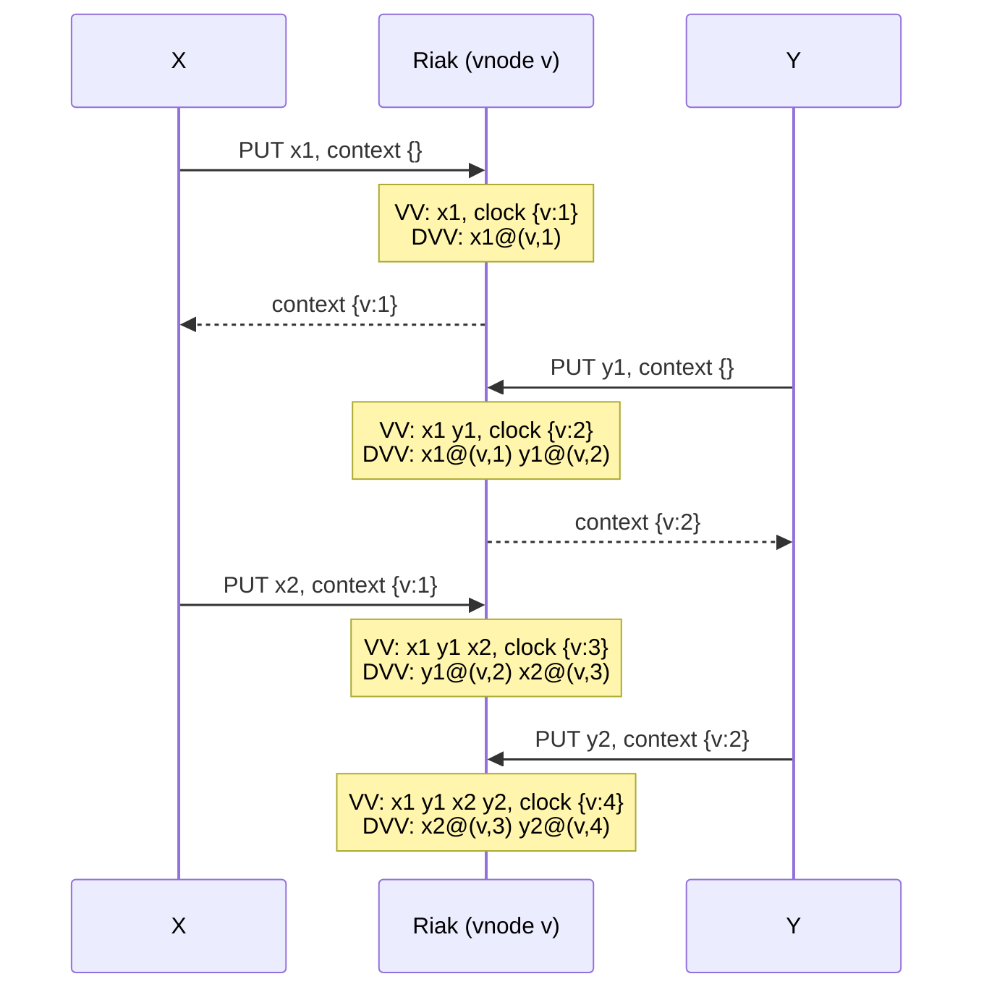

# Replicación leaderless

Dependencias y secuencia completa de la clase: [`main`](https://github.com/fiubaTA050/leaderless-replication/tree/main).

## Parte 3: Riak

Riak KV es el más parecido a Dynamo: consistent hashing, `N`/`R`/`W` por request, sloppy quorum con hinted
handoff, y conflictos que se le devuelven al cliente como **siblings** (en vez de LWW como Cassandra).

### Branch `4-riak-siblings`: siblings y dotted version vectors

```bash
git checkout 4-riak-siblings
cd riak
docker compose up -d --wait
```

Un solo nodo (la imagen es vieja, Riak 2.2.3, y en Apple Silicon corre emulada): alcanza para ver siblings, que
dependen del causal context y no de la cantidad de nodos. Ese nodo igual guarda `n_val = 3` copias en vnodes
distintos.

Bucket type con siblings (`allow_mult`) y dotted version vectors (`dvv_enabled`):

```bash
docker exec riak-riak-1 riak-admin bucket-type create siblings '{"props":{"allow_mult":true,"dvv_enabled":true}}'
docker exec riak-riak-1 riak-admin bucket-type activate siblings
```

#### 1. Causal context: `X-Riak-Vclock`

```bash
URL=localhost:8098/types/siblings/buckets/carts/keys/ana
curl -XPUT $URL -H 'content-type: text/plain' -d 'leche'
curl -I $URL
```

Cada GET devuelve el valor y un causal context opaco (`X-Riak-Vclock`): "estos son los writes que vi". El
cliente lo manda en el PUT siguiente para decir qué valores reemplaza.

#### 2. Dos writes concurrentes con el mismo context

Los dos clientes leyeron el mismo carrito y agregan cosas distintas:

```bash
VCLOCK=$(curl -sI $URL | awk '/X-Riak-Vclock/ {print $2}' | tr -d '\r')
curl -XPUT $URL -H 'content-type: text/plain' -H "X-Riak-Vclock: $VCLOCK" -d 'leche,pan'
curl -XPUT $URL -H 'content-type: text/plain' -H "X-Riak-Vclock: $VCLOCK" -d 'leche,huevos'
```

Ninguno vio al otro: son concurrentes y Riak guarda los dos.

```bash
curl -i $URL
curl $URL -H 'Accept: multipart/mixed'
```

`300 Multiple Choices` con la lista de siblings; con `multipart/mixed`, los dos valores. `leche` ya no está como
sibling: los dos writes lo reemplazaban.

#### 3. El cliente hace el merge

El cliente combina los siblings (acá, unión de items) y escribe el resultado con el context del `300`, que cubre
a los dos siblings:

```bash
VCLOCK=$(curl -sI $URL | awk '/X-Riak-Vclock/ {print $2}' | tr -d '\r')
curl -XPUT $URL -H 'content-type: text/plain' -H "X-Riak-Vclock: $VCLOCK" -d 'leche,pan,huevos'
curl -i $URL
```

`200 OK` con un solo valor. Un PUT **sin** context es concurrente con todo y genera otro sibling:

```bash
curl -XPUT $URL -H 'content-type: text/plain' -d 'yerba'
curl $URL -H 'Accept: multipart/mixed'
```

El merge es lógica de la aplicación: con unión, un item que un cliente borró y otro no vuelve a aparecer (el
carrito de Dynamo).

##### Merge de una entidad de negocio

Con un string de items el merge es fácil. Con una entidad real, por ejemplo una orden, los siblings son dos
versiones completas de la entidad:

```json
{ "items": [{ "sku": "A", "qty": 2 }],              "address": "Paseo Colón 850",  "status": "paid",      "total": 200 }
{ "items": [{ "sku": "A", "qty": 1 }, { "sku": "B" }], "address": "Av. Las Heras 2214", "status": "cancelled", "total": 250 }
```

¿Cuál es el merge correcto? No hay una respuesta genérica:

- **Sin la versión original no se sabe qué cambió cada uno**: Riak devuelve los siblings, no el ancestro común. Si
  `B` está en un sibling y no en el otro, ¿uno lo agregó o el otro lo borró? Unión resucita borrados, intersección
  pierde agregados.
- **Mismo campo, valores distintos**: dos direcciones, dos cantidades del mismo item. Elegir una pierde la intención
  de alguien; mezclar campos de versiones distintas (calle de una, ciudad de otra) arma una entidad que nadie
  escribió, como la fila mezclada de `2-cassandra-lww`.
- **Campos que dependen de otros**: `total` se calcula con los items, descuentos e impuestos. Mergear campo por
  campo deja un `total` inconsistente; hay que recalcularlo con las reglas de negocio.
- **Máquinas de estado**: `paid` y `cancelled` a la vez no es un merge, es una decisión de negocio (¿reembolso?).
  Y los efectos de cada versión ya ocurrieron: el pago se cobró, el mail de cancelación se mandó, el stock se
  reservó.
- **Invariantes**: dos versiones válidas pueden dar una inválida (stock negativo, cupón de un solo uso aplicado
  dos veces, límite de crédito superado): los invariantes no I-confluent de `main`.
- **El merge también tiene que converger**: puede haber más de 2 siblings, y dos clientes pueden hacer el merge a
  la vez. Si no da el mismo resultado sin importar el orden ni las repeticiones, el merge genera siblings nuevos.
  Todos los clientes tienen que correr el mismo código de merge, incluso con versiones distintas de la aplicación
  (y del schema de la entidad) en producción al mismo tiempo.
- **El conflicto aparece tarde**: se resuelve en el próximo read, que puede ser días después y en otro servicio,
  sin el contexto de quién cambió qué ni por qué.

Qué se hace en la práctica:

- Guardar operaciones en vez de estado ("agregó B", "cambió la dirección"), con un id único cada una, y calcular el
  estado a partir de ellas: el merge pasa a ser juntar operaciones.
- Partir la entidad en keys más chicas (items, dirección, estado por separado) para que los conflictos sean más
  chicos y más fáciles de resolver.
- Marcar los borrados (`"removed": true`) en vez de sacar el elemento, para distinguir "borrado" de "nunca lo vi".
- Mostrarle el conflicto a una persona cuando no hay regla automática (como un merge conflict de git).
- Lo que tiene invariantes fuertes (pagos, stock) va a una base con coordinación (leader, transactions).

#### 4. Dotted version vectors y sibling explosion

Un **version vector** es un mapa `{nodo: contador}` que resume qué writes se vieron: `{v:3}` significa "vi los
writes 1, 2 y 3 del nodo `v`". Se comparan entrada por entrada: si `A ≤ B` en todas, `B` desciende de `A` (lo
reemplaza); si ninguno es `≤` que el otro, son concurrentes (siblings).

Riak 2 sin DVV guarda **un solo** version vector por objeto, con una entrada por vnode (no por cliente, para que
no crezca con cada cliente que escribe). Todos los siblings comparten ese clock. Cuando llega un PUT con un
context viejo, el vnode sabe que el cliente no vio todo, pero no sabe **cuáles** siblings vio: el clock dice "vi
`v:1`", y ningún sibling dice "yo soy `v:1`". Así que guarda todos los siblings y agrega el nuevo.

Un **dotted version vector** (DVV) mantiene el context por vnode, pero además cada sibling guarda su **dot**
`(vnode, contador)`: el write exacto que lo creó. Un PUT con context `C`:

1. Elimina los siblings cuyo dot está cubierto por `C` (`(v, n)` con `n ≤ C[v]`): el cliente los vio y los
   reemplaza.
2. Conserva los demás: son concurrentes con el PUT.
3. Agrega el valor nuevo con un dot nuevo `(v, máximo + 1)`.

Las dos primeras rondas de `explosion.sh` (X e Y escriben alternados, cada uno con el context que recibió en su
propio write anterior), con un solo vnode `v`:



- **VV** (**sibling explosion**): `x2` viene con context `{v:1}`, más viejo que el clock `{v:2}`, así que Riak
  conserva todo, incluido `x1`, que X ya había visto y estaba reemplazando. Cada ronda suma 2 siblings, para
  siempre, aunque nunca hay más de 2 writes concurrentes.
- **DVV**: el context `{v:1}` cubre el dot de `x1`, así que `x2` lo reemplaza; `y1` (`(v,2)`) no está cubierto y
  queda como sibling. Siempre quedan solo los 2 writes realmente concurrentes.

¿Y un version vector con una entrada por cliente? También resuelve la explosión, pero crece con cada cliente que
alguna vez escribió (miles), y recortarlo (pruning) pierde información de causalidad: siblings falsos o writes
perdidos. Con DVV el tamaño queda acotado por la cantidad de réplicas.

```bash
docker exec riak-riak-1 riak-admin bucket-type create vclocks '{"props":{"allow_mult":true,"dvv_enabled":false}}'
docker exec riak-riak-1 riak-admin bucket-type activate vclocks
./explosion.sh
```

`explosion.sh`: X e Y escriben alternados en la misma key, cada uno con el context de su propio write anterior.
Con `vclocks` los siblings crecen de a 2 por ronda (`x1 … x5 y1 … y5`); con `siblings` (DVV) quedan
siempre los 2 últimos (`x5 y5`).

```bash
docker compose down -v
cd ..
```

**Siguiente:** [`5-crdt-lww`](https://github.com/fiubaTA050/leaderless-replication/tree/5-crdt-lww)
